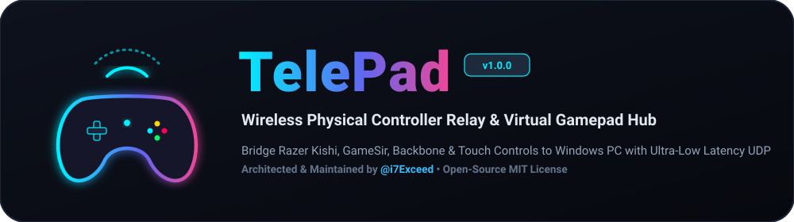

<div align="center">



<br/>

[](LICENSE)
[](https://dotnet.microsoft.com/)
[](https://flutter.dev/)
[](https://github.com/ViGEm/ViGEmBus)
[](https://github.com/)
[](https://github.com/)

**The ultimate low-latency bridge turning any mobile hardware controller or smartphone screen into a native Windows Xbox 360 controller.**

[Features](#-key-features) • [Architecture](#-architecture) • [Getting Started](#-getting-started) • [Internationalization](#-internationalization-i18n) • [Third-Party Credits](#-third-party-notices--legal-credits) • [Contributing](#-contributing)

</div>

---

## ⚡ What is TelePad?

**TelePad** is an open-source, ultra-low latency wireless controller bridge and virtual input hub architected by **i7Exceed**. 

While many apps provide basic touchscreen controls, **TelePad's core strength is its Physical Controller Relay**:
It connects directly to mobile telescoping gamepads (such as the **Razer Kishi**, **GameSir X-Series**, **Backbone One**, or standard Bluetooth gamepads) plugged into your Android smartphone via USB-C OTG, and relays hardware input packets instantaneously over your local Wi-Fi to a Windows PC—emulating a genuine, hardware-level **Xbox 360 Controller** using the kernel-mode **ViGEmBus** driver.

```
🎮 Gamepad (USB-C / BT) 
         │
         ▼
  📱 Android Device (TelePad Client) ──[ Raw UDP Packets ]──► 💻 Windows PC (TelePad Server)
         │                                                           │
         ▼                                                           ▼
  • AMOLED Black Saver                                        • Xbox 360 Controller (ViGEmBus)
  • Virtual Gamepad Layout                                    • Mouse & Trackpad Simulation
  • Force Feedback (Rumble)                                   • Real-time Input Visualizer
```

---

## ✨ Key Features

* 🎮 **Physical Controller Relay**:
  * Transforms your phone + snap-on gamepad (GameSir, Razer Kishi, Backbone) into a premium wireless PC controller with zero tethered cable clutter.
  * Intercepts native Android hardware HID events and dispatches them over raw UDP with sub-millisecond overhead.
* 🕹️ **Virtual On-Screen Gamepad**:
  * Ergonomic diamond face buttons (A / B / X / Y), tactical D-Pad cross, responsive analog sticks, bumpers (LB/RB), and triggers (LT/RT).
  * Smooth adaptive layout supporting both **Landscape** (optimal thumb grip) and **Portrait** orientations.
* 🖱️ **Precision Virtual Trackpad**:
  * Converts the phone screen into a Windows laptop trackpad.
  * Single tap for left click, two-finger tap for right click, continuous dual-finger dragging for mouse wheel scrolling.
* 🌐 **Full Internationalization (i18n)**:
  * Built-in multi-language localization supporting **English** (`en`) and **Bahasa Indonesia** (`id`) with instant in-app switching without restarting.
* 🌙 **AMOLED / OLED Battery Saver**:
  * Dim the smartphone display to 100% true pitch-black (`#000000`) during physical controller relay sessions to protect against screen burn-in and save battery.
* 📳 **Bi-directional Haptic Force Feedback**:
  * TelePad Server captures real-time rumble signals from Windows PC games and relays them to the phone's vibration actuator motor.
* 🔍 **Smart Subnet Auto-Discovery**:
  * Adaptive UDP broadcast scanner that discovers active TelePad PC servers across complex multi-adapter subnets in seconds.
* 🎨 **Cyber Neon Dark Theme**:
  * Sleek aesthetic featuring Deep Obsidian, Cyber Neon Cyan, Electric Indigo, and Carbon accents.
* 🔒 **PIN Security Pairing**:
  * Optional 4-digit PIN authentication to prevent unauthorized devices on shared Wi-Fi networks from hijacking PC controls.

---

## 📐 Architecture

```mermaid
flowchart LR
    subgraph Mobile["📱 Android Client (TelePad Client)"]
        direction TB
        HID["🎮 Hardware Controller (USB-C OTG / BT)"] --> Relay["Input Relay Engine"]
        Touch["👆 Touch Surface (Virtual / Trackpad)"] --> Relay
        Relay --> UDP_Client["UDP Socket Streamer"]
        VibEngine["📳 Haptic Actuator"] <-- Rumble["Vibration Feedback Listener"]
    end

    subgraph Network["🌐 Local Wi-Fi Subnet"]
        UDP_Client -->|Low-Latency UDP (Port 8888)| UDP_Server
        Rumble <--|Feedback Packets (VIB)| UDP_Server
    end

    subgraph PC["💻 Windows PC (TelePad Server)"]
        direction TB
        UDP_Server["UDP Input Listener"] --> Router{"Packet Router"}
        Router -->|"Type 'B' (Button) & 'A' (Axis)"| ControllerMgr["Virtual Controller Manager"]
        Router -->|"Type 'M' (Mouse) & 'MC' (Click)"| MouseMgr["Virtual Mouse Manager"]
        ControllerMgr --> ViGEm["Nefarius.ViGEm.Client SDK"]
        ViGEm --> Driver["ViGEmBus Kernel Driver"]
        Driver --> Game["🎮 Windows Games / Steam / Emulators"]
        MouseMgr --> Win32["Win32 mouse_event API"]
    end
```

---

## 🛠️ Prerequisites

1. **Windows PC**:
   * Windows 10 or Windows 11 (64-bit).
   * **[ViGEmBus Driver](https://github.com/ViGEm/ViGEmBus/releases)** installed. *(Essential for emulating the virtual Xbox 360 controller).*
   * **[.NET 10.0 Runtime](https://dotnet.microsoft.com/download)** (Windows Desktop Runtime).
2. **Android Phone**:
   * Android 8.0 (Oreo) or newer.
   * Both PC and phone connected to the **same Wi-Fi network / local subnet**.

---

## 🚀 Getting Started

### 1. Launching Windows Server (`TelePadServer`)

#### Option A: Run Pre-built Release
1. Download the latest release from the [Releases](https://github.com/) tab.
2. Ensure **ViGEmBus** is installed.
3. Run `TelePadServer.exe`.
4. Click **Start TelePad Server** (Default port is `8888`).

#### Option B: Build from Source
```powershell
# Navigate to the server folder
cd TelePadServer

# Build and run the Release executable
dotnet run --configuration Release
```

---

### 2. Launching Android Client (`telepad`)

#### Option A: Install APK
1. Download `telepad-release.apk` on your phone.
2. Install and launch **TelePad**.

#### Option B: Build with Flutter
```powershell
# Navigate to the flutter app folder
cd telepad

# Get dependencies
flutter pub get

# Run on connected Android device
flutter run --release
```

---

### 3. Pairing & Playing

1. Open **TelePad** on your Android device.
2. Tap **Scan Network** in the top bar. The app will auto-detect your PC name and local IP.
3. Tap your PC to connect. *(If manual connection is preferred, enter the IP address and tap Connect).*
4. Choose your preferred mode:
   * **Physical Relay**: Plug in your mobile controller (GameSir / Kishi / Backbone) and play directly!
   * **Virtual Gamepad**: Use on-screen buttons and joysticks.
   * **Virtual Touchpad**: Control your Windows cursor like a laptop trackpad.

---

## 🌐 Internationalization (i18n)

TelePad provides built-in multi-language support. You can switch languages on the fly:
1. Tap the **Settings icon (⚙️)** in the top right corner of the mobile app.
2. Under **Language / Bahasa**, select:
   * 🇺🇸 **English** (`en` - Default)
   * 🇮🇩 **Bahasa Indonesia** (`id`)
3. The interface immediately updates all labels, tooltips, and status cards.

---

## 🔧 Firewall & Troubleshooting

* **Firewall Popup on Windows**: When launching `TelePadServer.exe` for the first time, Windows Defender Firewall will ask for permission. Click **Allow access on Private networks**.
* **Controller Not Recognized in Games**: Make sure you have installed the official [ViGEmBus installer](https://github.com/ViGEm/ViGEmBus/releases). The TelePad Server GUI will display `Driver: ViGEmBus Ready` in green when properly hooked.
* **Network Isolation**: Ensure your Wi-Fi router does not have "AP Isolation" or "Guest Network Client Isolation" enabled, which blocks direct phone-to-PC UDP communication.

---

## ⚖️ Third-Party Notices & Legal Credits

TelePad acknowledges and respects the intellectual property and contributions of the open-source community:

* **[ViGEmBus](https://github.com/ViGEm/ViGEmBus) & [Nefarius.ViGEm.Client](https://github.com/ViGEm/ViGEm.NET)**:
  * Authored by **Benjamin Höglinger-Stelzer** ([Nefarius Software Solutions e.U.](https://github.com/nefarius)).
  * Licensed under MIT / BSD-3-Clause.
  * Used by TelePad Server to interface with kernel-mode virtual gamepad drivers on Windows.
* **[gamepads](https://github.com/flame-engine/gamepads)**:
  * Maintained by Flame Engine / Giancarlo Rocha (MIT License).
* **[vibration](https://pub.dev/packages/vibration)**:
  * Maintained by Ben Kuka (MIT License).
* **[wakelock_plus](https://github.com/fluttercommunity/plus_plugins)**:
  * Maintained by CreativeCreatorORM & Flutter Community (BSD-3-Clause).

For comprehensive licensing statements, see [THIRD_PARTY_LICENSES.md](THIRD_PARTY_LICENSES.md).

### 🏷️ Trademark Disclaimer
*Microsoft, Windows, Xbox, and Xbox 360* are registered trademarks of Microsoft Corporation. *Razer, Razer Kishi, GameSir, Backbone, PlayStation, DualShock*, and other product names are trademarks of their respective owners. These trademarks are referenced strictly for hardware compatibility and descriptive purposes under fair use.

---

## 📜 License

TelePad is licensed under the **[MIT License](LICENSE)**.

```
Copyright (c) 2026 i7Exceed
```

You are free to use, copy, modify, merge, publish, distribute, sublicense, and/or sell copies of the software with proper attribution to the original author.

---

## 👨‍💻 Author & Acknowledgement

Crafted with ❤️ by **[i7Exceed](https://github.com/)**.

Contributions, bug reports, and pull requests are warmly welcome! Please read [CONTRIBUTING.md](CONTRIBUTING.md) to get started.
